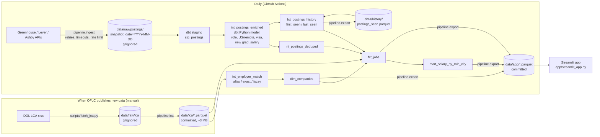

# 🔭 SponsorScope

**Live US data/ML and software job postings, each flagged by whether the employer has H-1B sponsorship history, so international grads can find sponsor-friendly jobs.**

**Live demo:** _coming soon (Streamlit Community Cloud link goes here)_

---

## The problem

International students and grads on F-1/OPT spend hours on a question job boards don't answer: *will this employer sponsor an H-1B?* Postings rarely say, and when they do, the wording varies ("unable to sponsor", "must be authorized to work without sponsorship", "we do sponsor visas"). SponsorScope combines live postings with the US Department of Labor's public H-1B filing records, so you can filter to employers that actually sponsor and see what each posting says about visas.

## What it does

- **Live postings** from the public job-board APIs of ~300 tech companies (Greenhouse, Lever, Ashby), refreshed daily. US and remote roles only.
- **Role normalization**: data scientist, data engineer, ML engineer, AI engineer, data analyst, analytics engineer, research scientist, software / backend / frontend / full-stack / mobile engineer, platform / DevOps / SRE.
- **H-1B badge** per employer: FY2025 certified H-1B Labor Condition Applications (LCAs), top sponsored titles, median LCA wage, worksite states.
- **Visa-language flag** per posting: *no sponsorship* / *sponsorship available* / *not mentioned*.
- **New-grad flag** (new grad, entry level, junior, 0–2 years of experience).
- **Salary**: the posted pay range (annualized) next to the employer's median H-1B LCA wage for that role family.
- **Company view** and **salary insights** by role and city.

## Data sources

| Source | What | How |
|---|---|---|
| [Greenhouse Job Board API](https://developers.greenhouse.io/job-board.html) | Postings | `boards-api.greenhouse.io/v1/boards/{token}/jobs?content=true` |
| [Lever Postings API](https://github.com/lever/postings-api) | Postings | `api.lever.co/v0/postings/{site}?mode=json` |
| [Ashby Job Posting API](https://developers.ashbyhq.com/docs/public-job-posting-api) | Postings + structured pay | `api.ashbyhq.com/posting-api/job-board/{name}?includeCompensation=true` |
| [US DOL OFLC LCA disclosure data](https://www.dol.gov/agencies/eta/foreign-labor/performance) | H-1B filings | FY2025 Q1–Q4 `LCA_Disclosure_Data_FY2025_Q*.xlsx` (Oct 1 2024 – Sep 30 2025; 582,269 H-1B LCAs from 61,934 employers) |

No LinkedIn / Indeed scraping. The company list (`seeds/companies.csv`) was built from 522 candidate board tokens, each checked live against all three APIs. Dead or empty boards and tokens pointing to the wrong company were dropped, leaving **313 live boards**.

## Pipeline



- **Python 3.11, DuckDB, dbt-duckdb.** Parsing rules live in the `pipeline/` package, where they're unit-tested. dbt applies them through Python models and does the joins and marts in SQL.
- **dbt tests**: `not_null`, `unique`, `accepted_values` (ATS, role, role group, visa status, match method) and `relationships`, plus singular tests (`first_seen <= last_seen`, salary ranges sane). 47 checks run on every build.
- **History accumulates**: each run unions today's postings with the committed `postings_seen.parquet`, so `first_seen` / `last_seen` per job builds up daily for future trend features.
- **Repo stays small**: raw snapshots and the raw LCA spreadsheets (~420 MB) are gitignored. Only the aggregated parquet (~3.5 MB LCA, ~0.4 MB app data) is committed.

## Methods

**Role normalization** (`pipeline/roles.py`): ordered regex rules on the title. Specific roles win over generic ones ("Software Engineer II, Backend" → Backend Engineer; "Data Engineer, ML Platform" → Data Engineer). Managers, directors, recruiters, sales/solutions engineers, IT, and hardware titles (ASIC, RTL, firmware, mechanical...) are excluded unless the title says "software".

**US / remote filter** (`pipeline/location.py`): parses state abbreviations and names, common metros ("NYC", "Bay Area"), and non-US cities and countries. The ATS country field is used only when the location text itself says nothing. "Remote" with no country counts as US remote, since every board is a US company; "Remote Canada" doesn't.

**Visa-language detector** (`pipeline/visa.py`): rules run sentence by sentence on sentences about sponsorship, visas, work authorization or citizenship. Application-form questions ("Will you now or in the future require sponsorship?") and EEO boilerplate ("regardless of citizenship status") are ignored. Hedges ("we can't sponsor for *every* role") don't count as refusals. If a posting has both kinds of sentence, a refusal beats a positive statement. Citizenship and active-clearance requirements count as *no sponsorship*. About 40 tricky phrasings are covered by tests.

**New-grad flag** (`pipeline/newgrad.py`): title keywords (new grad, entry level, junior, "Engineer I", early career). Senior, staff, lead and level II+ titles override them. Otherwise the description's binding experience requirement (the largest "N+ years of experience" found) must be ≤ 1 year ("0–2 years", "1+ years", "up to 2 years" qualify; "2+ years" doesn't). Internships are flagged separately.

**Salary** (`pipeline/salary.py`): structured pay first (Lever `salaryRange`, Ashby compensation), then regex over the description (`$120K–$150K`, `$120,000 - $150,000 USD`, `$45/hr - $55/hr`, single "base salary of $185,000"). Pay is annualized (2,080 h/yr) with sanity bounds, and non-USD amounts are rejected. The **employer's LCA median wage** for the same role family is shown alongside as context.

**Employer matching** (`pipeline/employer_match.py`): job-board names are matched to LCA employer names by:
1. a manual alias for brands whose legal name differs (Instacart → Maplebear Inc., SpaceX → Space Exploration Technologies Corp., Cursor → Anysphere, Inc.); an alias of `-` blocks a known false match;
2. an exact match on the normalized name (lowercased, punctuation and legal suffixes like Inc./LLC/Labs removed);
3. a strict fuzzy match (RapidFuzz ratio ≥ 92 with the same first word, so "Ramp" never matches "Rampart Systems").

**Current match rate: 246 / 313 companies (78.6%), covering 85.7% of open postings.** Each daily run writes the live numbers to `data/app/meta.json`.

**Sponsor-friendly** (app filter): the employer has at least *N* certified FY2025 H-1B LCAs (default 1, adjustable) **and** the posting doesn't say it won't sponsor.

## Limitations

- **Coverage**: only companies whose careers pages run on Greenhouse, Lever or Ashby. Large sponsors on Workday, iCIMS or custom sites (Amazon, Google, Microsoft, Meta, big banks) are missing.
- **LCA filings ≠ hires.** An LCA is a step before the H-1B petition. Employers file more LCAs than they hire, and one person can have several. Certified LCAs show *willingness to sponsor in FY2025*, not a guarantee today.
- **Data lags**: LCA data covers Oct 2024 – Sep 2025. Postings are a daily snapshot, and a closed job can linger until the next run.
- **No match ≠ no sponsorship**: some employers file under a legal name we couldn't match (64 companies unmatched).
- **Rules can be wrong**: the visa language, new-grad, role and salary fields are heuristic.
- **Not legal advice.** H-1B history does not guarantee sponsorship for any role or candidate. Ask the employer and an immigration attorney or your DSO.

## How to run

Requires Python 3.11 (e.g. `pyenv install 3.11.9`).

```bash
make setup     # .venv + requirements-dev.txt
make test      # pytest (parsers, visa detector, new grad, matching, salary, app smoke test)
make lint      # ruff
make run       # ingest today's postings -> dbt build (with tests) -> export app data
make app       # streamlit run app/streamlit_app.py
```

Other targets:

```bash
make rebuild   # dbt build + export from the latest local snapshot, no fetching
make verify    # re-check candidate board tokens (seeds/candidate_companies.csv -> seeds/companies.csv)
make lca       # download the FY2025 LCA files and rebuild data/lca/*.parquet
```

`make lca` uses a headless browser (Playwright) because dol.gov's CDN rejects plain HTTP clients. It only needs to run when OFLC publishes a new quarter; the daily refresh never touches it.

**Repo layout**

```
app/                  Streamlit app + runtime requirements.txt (what Streamlit Cloud installs)
pipeline/             ingest, parsers/classifiers, LCA aggregation, export, run
dbt/                  dbt-duckdb project (staging -> intermediate -> marts, tests)
seeds/                candidate + verified job boards, employer aliases
data/lca/             aggregated H-1B LCA parquet (committed)
data/app/             app data, refreshed daily (committed)
data/history/         first_seen / last_seen per posting (committed)
data/raw/             raw snapshots + LCA xlsx (gitignored)
tests/                pytest suite + small fixture snapshot used by CI's dbt build
.github/workflows/    ci.yml (lint, tests, dbt build) and daily-refresh.yml
```

## Roadmap (not built yet)

Resume matcher · skill-gap analyzer · daily digest email · hiring velocity · skill trends over time · Airflow orchestration.
